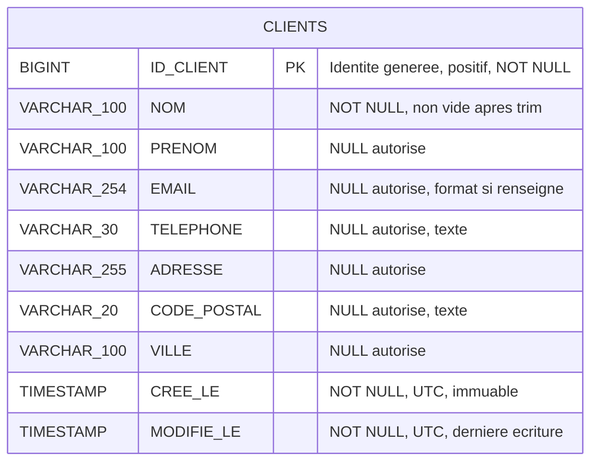
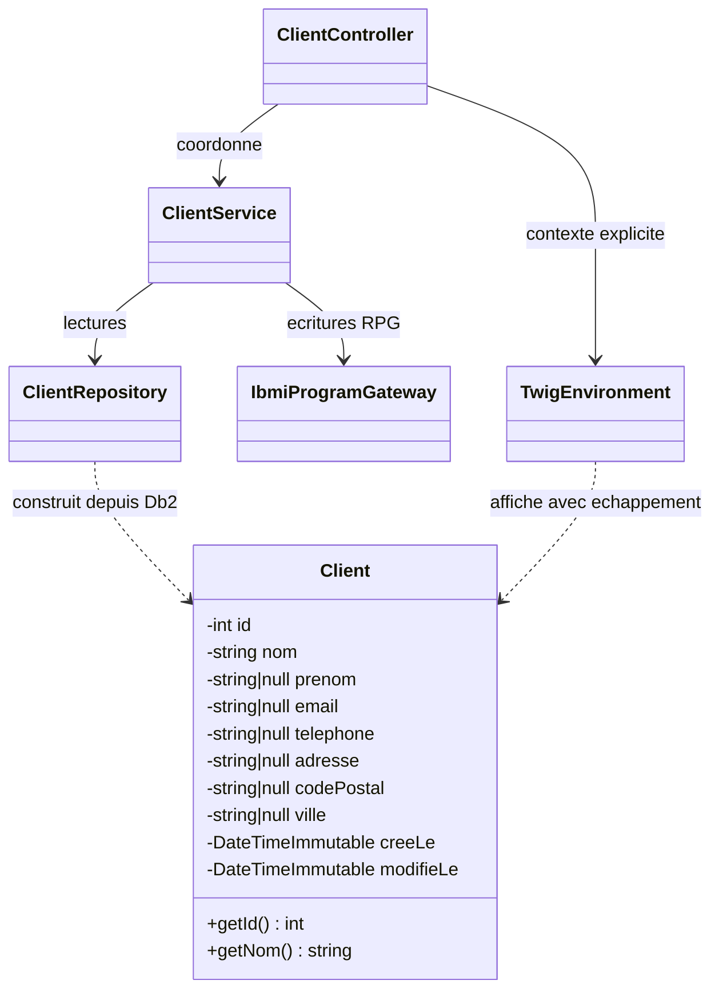
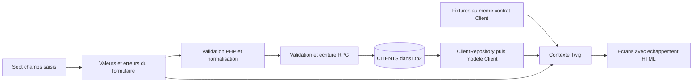

# Diagrammes du contrat client — issue #1

Ces diagrammes précisent le [contrat des données et des écrans](../modele-donnees.md).
Ils complètent les PNG existants sans changer l'architecture. Le PNG du modèle
est une proposition de départ et celui des classes laisse explicitement les
types facultatifs à préciser : les types définitifs sont ceux ci-dessous.

## Table CLIENTS

Une seule entité est nécessaire. Aucune colonne de référence d'affichage n'est
ajoutée. Les suffixes `100`, `254`, etc. représentent les limites de caractères.

## Types du modèle PHP

`string|null` correspond à `?string` en PHP. Ces types remplacent les `string`
génériques des champs facultatifs dans le PNG des classes ; les dates utilisent
`DateTimeImmutable` plutôt que `DateTime`. Les autres responsabilités du
[diagramme de classes](02_Diagramme_de_classes.png) sont conservées.

## Données de saisie et de présentation

Le parcours fixtures ne passe pas par Db2. Les valeurs de formulaire restent
des chaînes, les champs métier facultatifs deviennent `null` après normalisation.
La référence sur six chiffres minimum est calculée à l'affichage. Aucun texte
pré-encodé en HTML n'est stocké.
