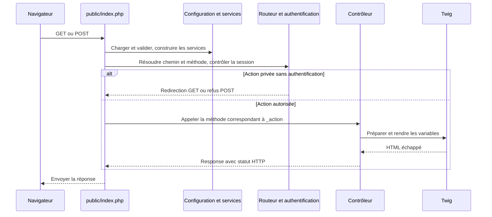

# Comprendre et reprendre le code

Ce guide accompagne les commentaires des sources. Il décrit le comportement
actuel du dépôt : écrans alimentés par des fixtures, authentification web locale,
validation des formulaires sans sauvegarde et connexion Db2 disponible à la demande.
La présence d’un service de connexion ne signifie pas que les écrans lisent Db2.

## Parcours conseillé pour une première lecture

1. Lire [le modèle des données](modele-donnees.md) pour connaître les champs,
   leurs limites et les variables attendues par les vues.
2. Suivre [public/index.php](../web/public/index.php), le point d’entrée HTTP.
3. Lire les fichiers de [configuration](../web/config/) dans l’ordre :
   `bootstrap.php`, `services.php`, `routes.php`, `security-headers.php`.
4. Examiner [ClientController](../web/src/Controllers/ClientController.php)
   et [BaseController](../web/src/Controllers/BaseController.php), puis leurs vues.
5. Suivre l’authentification et la validation décrites ci-dessous.
6. Lire [app.js](../web/public/assets/js/app.js) pour comprendre les améliorations
   du navigateur, puis les sources SQL et le contrôle CLI pour IBM i.

Les commentaires PHPDoc précisent le rôle de chaque classe et méthode, les
structures de tableaux utiles, les erreurs et les effets sur la session.
Les commentaires dans les méthodes expliquent les étapes et leurs raisons.
Les commentaires Twig restent côté serveur et ne sont pas envoyés au navigateur.

## Une requête HTTP, du navigateur à la réponse

Apache expose uniquement `web/public/`. Pour les chemins qui ne correspondent
pas à un fichier ou dossier, `.htaccess` réécrit vers `index.php`.
Les sources, configurations, templates et dépendances restent hors de cette racine.

`bootstrap.php` charge l’autoload Composer, choisit `APP_ENV` et lit le fichier
INI local correspondant. Il contrôle les types, interdit debug/démonstration
en production, choisit le scénario et valide la configuration Db2 si elle est active.
Il retourne un tableau de paramètres ; il ne crée pas de connexion.

`services.php` retourne une fonction appelée avec cette configuration et la requête.
Elle construit la session, le CSRF, l’authentification, les routes, Twig et les
validateurs. Elle expose aussi un objet `Db2Connection` encore déconnecté.
Ce registre de services est un tableau simple, sans conteneur Symfony complet.

`routes.php` associe un nom à un chemin, des méthodes autorisées et une `_action`.
Le nom sert à `path()` dans Twig ; `_action` sert au `match` dans `index.php`.
Le routeur vérifie les contraintes d’ID et distingue une route absente (404)
d’une méthode interdite (405 avec en-tête `Allow`).

Avant de distribuer l’action, `index.php` contrôle l’authentification pour les
actions de `protectedActions`. Une requête sûre anonyme est redirigée vers
`/login` ; un POST privé anonyme reçoit 403. Une action de contrôleur retourne
une `Response` ; le point d’entrée lui applique `Cache-Control: no-store, private`
et l’envoie. Les erreurs techniques restent dans le journal et ne sont pas affichées.

## Qui fait quoi ?

| Source | Responsabilité actuelle |
|---|---|
| `Controllers/BaseController.php` | Rendre Twig, consommer les flash, construire les redirections |
| `Controllers/AuthController.php` | Traiter le formulaire de connexion et la déconnexion CSRF |
| `Controllers/ClientController.php` | Liste, recherche, fiche, formulaires et aperçus sur fixtures |
| `Services/Authentication.php` | Vérifier le compte local et gérer l’identité en session |
| `Services/ClientInputValidator.php` | Liste blanche des champs, normalisation et contraintes serveur |
| `Models/Client.php` | Transporter une fiche immuable, sans accès à une base |
| `Infrastructure/Db2Connection.php` | Ouvrir et réutiliser PDO_ODBC dans une instance |
| `fixtures/clients.php` | Fournir cinq objets fictifs avec cas de présentation variés |
| `bin/check-db2.php` | Tester depuis le terminal une connexion et un `SELECT COUNT(*)` |

Ces chemins sont relatifs à `web/`.
`ClientRepository.php`, `ClientService.php` et `IbmiProgramGateway.php` sont
des emplacements réservés, documentés par des commentaires : ils n’implémentent
aucune classe, lecture ni écriture.
Les responsabilités futures sont précisées dans [l’architecture](architecture-web.md)
et [la feuille de route](roadmap.md).

## Authentification et session

Le compte web de `auth.local.php` est distinct du profil IBM i de la configuration
ODBC. Le fichier privé contient un nom et un hash de mot de passe.
`Authentication::__construct()` valide ce format et calcule une empreinte du hash.

`AuthController::login()` affiche le formulaire en GET. En POST, il vérifie
successivement le jeton `auth_login`, les types/champs requis, puis les identifiants.
Les refus donnent respectivement 403, 422 et 401. Le mot de passe n’est jamais
retourné à Twig ; l’échec d’authentification garde un message générique.

`Authentication::login()` vérifie le mot de passe même si le nom est incorrect.
En cas de succès, il efface les données de session précédentes, renouvelle
l’identifiant en détruisant l’ancien et stocke le nom avec l’empreinte.
Le contrôleur retourne alors 303 vers la liste.

`username()` vérifie la structure de l’identité et sa correspondance avec le
compte configuré. Modifier le hash local invalide donc les identités anciennes.
`isAuthenticated()` repose sur ce contrôle, et non sur la simple présence d’une clé.
La déconnexion nécessite un POST et le jeton `auth_logout`, puis invalide la session.

Les cookies sont HttpOnly, SameSite=Lax et Secure sous HTTPS. La protection
CSRF reste nécessaire. Voir [la documentation de sécurité](securite-web.md)
pour l’installation et les contrôles complémentaires.

## Formulaires : valeurs, données et erreurs

`ClientController::form()` prépare le même contrat pour l’ajout et la modification.
Il préremplit les champs si un client existe, choisit la vue et crée un jeton
`client_create` ou `client_update_{id}`. Les jetons ne sont pas interchangeables.

`preview()` vérifie ce jeton avant de demander au validateur de traiter le POST.
Un jeton refusé donne 403. Le résultat de `validate()` comprend trois tableaux :

| Clé | Contenu | Usage |
|---|---|---|
| `values` | Saisies textuelles, sans normalisation | Réafficher ce que l’utilisateur a entré |
| `data` | Textes après `trim`, champs facultatifs vides remplacés par `null` | Préparer une future opération métier |
| `errors` | Messages par champ, ou `_global` | Résumé d’erreurs et aides associées aux champs |

Le validateur refuse les champs inconnus et les valeurs non textuelles.
`_token` est une métadonnée autorisée ; sa validité est contrôlée par le contrôleur.
Le nom est obligatoire ; les longueurs et le format e-mail sont vérifiés côté serveur.
Les valeurs ne sont pas pré-encodées en HTML : Twig effectue l’échappement à la sortie.

Un aperçu invalide répond 422 ; un aperçu valide répond 200 et indique explicitement
qu’aucun client n’a été enregistré. `ecritureActive` vaut actuellement `false`.
Les routes POST de création/modification réelles ne sont pas encore implémentées.

## Vues, styles et accessibilité

`base.html.twig` contient la structure commune : langue, ressources locales,
navigation, lien d’évitement, bandeau de démonstration, zone principale et pied de page.
`BaseController::render()` fournit `modeDemo` et les messages flash consommés
dans la session. La fabrique fournit `utilisateur`, `path()` et `csrf_token()`.

`clients/_form.html.twig` centralise les champs des deux formulaires. Les vues
`new` et `edit` lui transmettent explicitement ses variables avec `only`.
Les attributs `data-*` sont des points de liaison avec `app.js`.
Le résumé d’erreurs reçoit le focus ; les erreurs de champ sont reliées avec
`aria-describedby` et `aria-invalid`. `novalidate` laisse le serveur produire
les messages cohérents ; `maxlength` n’est pas une protection serveur.

La liste présente un tableau sur grand écran et une liste compacte en dessous
du breakpoint `lg`. Les classes Bootstrap contrôlent leur visibilité respective.
Les références sur six chiffres sont une présentation ; les URL gardent l’ID technique.
La fiche affiche les valeurs facultatives absentes avec un tiret et convertit
explicitement les dates lisibles en `Europe/Paris`.

`assets/css/app.css` surcharge Bootstrap pour la maquette. Les commentaires
repèrent le thème, les composants, le focus clavier et les adaptations aux tailles
d’écran ou à la réduction des animations. Les fichiers Bootstrap et les polices
distribués localement sont des dépendances ; conserver leurs licences.

## Recherche asynchrone

Sans JavaScript, le formulaire envoie un GET `/clients?q=Martin` et affiche
la page complète. `ClientController::index()` filtre actuellement le nom des fixtures
avec `mb_stripos`, puis rend `clients/index.html.twig`.

Avec JavaScript, chaque frappe programme `searchClients()` après 300 ms de pause.
Le bouton ou Entrée déclenche la recherche immédiatement. La composition IME
est respectée pour ne pas chercher un caractère en cours de construction.

`AbortController` annule la requête précédente ; un compteur `version` empêche
une ancienne réponse de remplacer les résultats récents, même après une course
entre requêtes. `fetch` récupère le HTML avec la session courante. `DOMParser`
en extrait `#resultats-clients`, dont seuls les enfants sont remplacés : le
champ conserve son focus. L’adresse est actualisée avec `history.replaceState`.

La zone de statut annonce le résultat sans déplacer le focus. Une erreur HTTP,
réseau ou un fragment absent produit un message visible et garde les anciens
résultats. Une annulation attendue reste silencieuse. Cette recherche ne constitue
pas encore une requête SQL vers Db2.

## Connexion et sources IBM i

`Db2Connection::getConnection()` refuse le mode désactivé, retourne la connexion
déjà ouverte ou vérifie la présence du pilote avant de construire PDO.
Les exceptions PDO sont remplacées par un message générique ; le journal ne
conserve qu’un code borné. Le constructeur ne contacte aucun serveur.

`composer check:db2` appelle `bin/check-db2.php`. Le script charge la configuration,
exige l’intégration active et PDO_ODBC, puis lit le compteur de `schema.CLIENTS`.
Le schéma est validé avant interpolation comme identifiant SQL. Aucune écriture
n’est exécutée. La sortie vaut 0 en cas de succès et 1 en cas d’échec.

L’ancien diagnostic HTTP `/diagnostics/db2` est désactivé : la route, son entrée
dans `protectedActions` et sa branche dans le `match` sont commentées. Ces blocs
ne sont pas exécutés et ne doivent pas être confondus avec une fonctionnalité
disponible. Le contrôle de connexion actif passe par `composer check:db2`.

Dans `ibmi/sql/clients.sql`, Db2 génère les identifiants ; les contraintes vérifient
nom obligatoire, longueurs métier et cohérence des dates. Les capacités UTF-8
sont prévues en octets, les limites métier en caractères. Les timestamps n’ont
pas de fuseau intégré : les instructions d’écriture doivent respecter l’UTC.
Le script `clients-test-data.sql` insère cinq clients fictifs et n’est pas idempotent.
Le rejouer ajoute cinq lignes ; ne pas le lancer comme un test sans conséquence.

Voir [l’installation Db2](connexion-db2.md) et [l’installation IBM i](../ibmi/sql/installation-ibmi.md).
Les droits du profil PUB400 propriétaire ne doivent pas être présentés comme
ceux d’un compte applicatif limité à la lecture.

## Fichiers de configuration et sources réservées

`dev.ini.example` décrit chaque paramètre dans des commentaires INI. Les valeurs
réelles sont à renseigner uniquement dans la copie locale. `.gitignore` explique
les groupes de fichiers exclus ; `.gitattributes` explique la normalisation des
fins de ligne. `public/.htaccess` documente la réécriture vers le point d’entrée.

`composer.json` est du JSON et ne permet pas les commentaires. Son bloc `require`
déclare PHP, PDO et les bibliothèques ; `autoload.psr-4` associe le namespace `App`
à `src/` ; `config.sort-packages` ordonne les dépendances ; `suggest` explique
le besoin optionnel de PDO_ODBC ; `scripts.check:db2` lance le contrôle CLI.
`composer.lock` est généré par Composer : ne pas le commenter manuellement.

Les deux fichiers `CLTADD.sqlrpgle` et `CLTUPD.sqlrpgle` contiennent uniquement
des commentaires décrivant les futurs programmes. Ils ne constituent pas encore
des programmes à compiler. Les dépendances externes, polices, licences et fichiers
binaires ne sont pas du code applicatif à commenter.

## Modifier le projet et vérifier son travail

Pour ajouter un champ, adapter ensemble le modèle, les fixtures, la liste blanche
du validateur, les métadonnées du formulaire, les vues concernées, le contrat
documenté et le schéma Db2. Les futures écritures RPG devront partager ce contrat.

Pour ajouter un écran privé, déclarer sa route, distribuer sa `_action` dans
`index.php` et l’ajouter au contrôle d’accès. Un POST doit vérifier le jeton CSRF
et les saisies avant toute opération métier. Un succès d’écriture ne doit être
annoncé qu’après confirmation de l’opération réelle.

Depuis `web/`, lancer `composer validate --strict` et `composer check-platform-reqs`,
puis vérifier la syntaxe PHP des fichiers modifiés. Contrôler les parcours dans
le navigateur avec et sans JavaScript : connexion, refus CSRF, recherche,
formulaires invalides, navigation clavier et petits écrans. `composer check:db2`
nécessite la configuration privée, le pilote IBM et l’accès réel au serveur.

**Limite connue :** `web/tests/smoke.php` est un ancien test, désynchronisé depuis
l’ajout de l’authentification. Il utilise encore le mauvais service de validation
et d’anciens identifiants CSRF ; la fabrique exige désormais le compte local.
Il doit être adapté avant de pouvoir servir de contrôle de régression fiable.
Les commentaires ajoutés ne corrigent pas cette logique.

Ne jamais copier de secrets dans des commentaires, exemples, journaux ou rapports
de test. Les fichiers INI locaux, comptes privés et magasins de certificats restent
hors du dépôt. Décrire les raisons d’une règle près du code et mettre ce guide
à jour lorsque le parcours d’une requête ou une intégration change.
